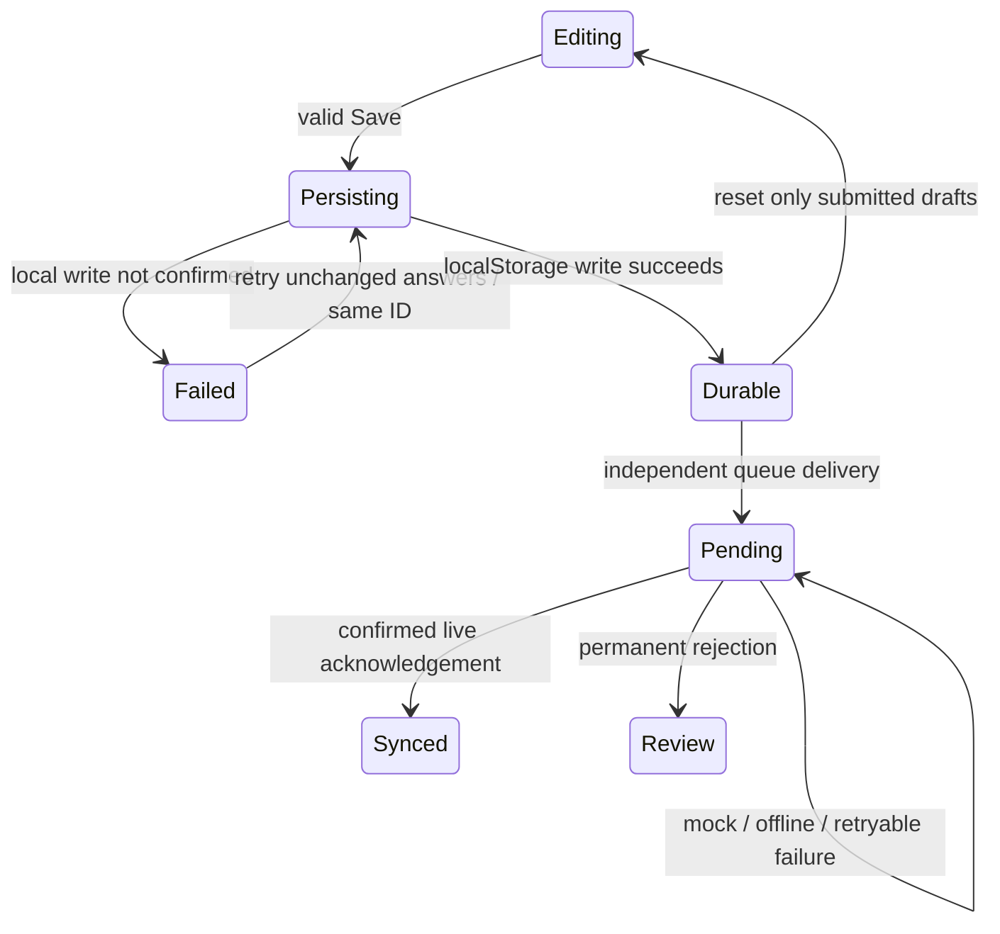

# Application state contracts

This is the implementation map for the audit in #109 and its follow-ups #110–#119.
Keep this map and AGENTS.md current when ownership, events or storage formats change.
Use small TypeScript unions and pure selectors where they prevent invalid combinations.
The browser continues to own its native service-worker lifecycle. No state-machine
framework or new runtime dependency is needed.

## Recording and saving

| Machine | States / events | Owner and invariant |
| --- | --- | --- |
| Destination | shift + bounded step; standalone WQ; Room 6 + section; History | `entryDestination.ts`, home page. Construct numeric steps with `shiftDestination`; forward movement still passes `canNavigate` and shared validation. |
| Room / remembered destination | Room 12 / Room 6; last Room 12 tab, last Room 6 section | Home page and `homeTab.ts`. Changing rooms retains draft answers and previous Room 6 section. |
| URL synchronisation | unchanged URL, URL changed, click awaiting shallow navigation | `createHomeTabObserver`. React to changes in the URL, not rerenders against the old URL. URL failure must not discard drafts. |
| Header menu | closed / open; click, Escape, outside click, destination selected | `SiteHeader.svelte`. Preserve the existing mobile focus return and dedicated recording tablist. |
| Draft context | date/initials per draft; explicit date change; submitted-draft reset | Home page, `shiftWorkflow.ts`. AM/off-day share AM/WQ drafts; PM and Room 6 sections retain separate drafts. |
| Save transaction | editing → persisting → durable, or failed → retry | `saveState.ts`, `persistNewSubmission`, home page. One immutable payload/ID per unchanged failed attempt. A deliberate change in answers starts a different attempt. |
| Validation presentation | pristine / revealed; reveal, edit, context changed | `validationFeedback.ts`, `validationGuide.ts`. Visibility is separate from validity. Only standalone Room 12 WQ flags entered-invalid values before reveal, preserving current behaviour. |
| Individual answer | unanswered / entered / explicitly not measured | `waterQualityMeasurements.ts`. Parsing does not establish validity; `getModuleIssues` does. Not measured → edit returns unanswered, requiring a new answer. |
| Conditional answers | routine / weekly; welfare N → concerns; positive egg count → IDs; flow N → notes | `validation.ts`, form components. Weekly exclusion retains the draft values but exports blank chemistry. Never infer or auto-fill required measurements. |
| Shift and legacy schemas | AM / PM / pre-split LSS; legacy Room 6 / current sections; feed/med completion | `validation.ts`, `rows.ts`, config modules. Keep old queued payloads valid under their original rules; new AM/PM rows leave the other half blank. |

The date picker applies **only to the visible workflow's sections**. A completed
multi-section save creates empty submitted drafts dated today in Brisbane. It never
re-dates unrelated drafts. On returning to another workflow, the picker shows that
workflow's retained date. Shared WQ can therefore differ from the AM draft after a
standalone edit; show both dates and require an explicit “Use [date] for these sections”
or picker change before a combined save. `createEntryPayload` also rejects date mismatches.

`persistNewSubmission` returns immediately after the durable write, without waiting
for a backlog or rereading the new record. The receipt tracks that record ID and
updates on later queue writes. Rejected records remain stored, with a needs-review
receipt; they cannot silently become another automatic form save. `queueSubmission`
remains an adapter for callers that explicitly want to await a delivery attempt.

## Queue, persistence and transport

| Machine | States / events | Contract |
| --- | --- | --- |
| Record delivery | pending / needsReview / synced | `deliveryState` interprets existing `synced`/`syncBlocked` fields. No persisted submission format migration. Only a confirmed live response marks synced. |
| Drain | idle / in flight / finished | `storage.ts`. Coalesce drains in one JS context; separate tabs may compete, so server atomic receipts remain authoritative. |
| Scheduler | idle / running / stopped; startup, online, offline, retry, teardown | `autoSync.ts`. Bounded 5–60 second backoff. Teardown prevents timers/status callbacks after an in-flight attempt returns. An existing durable attempt may still finish. |
| Authentication hold | absent / required / verifying / cleared | `syncPause.ts`, `authSync.ts`. Only a successful network `/api/access` check clears it; never a cached shell or manual Sync click. |
| Cooldown | absent / deadline pending / expired | `syncPause.ts`. 429/503 persist the deadline. Authorisation never clears this independent hold. |
| Device snapshot | unavailable / ready; upToDate, pending, syncing, needsReview, signInRequired, cooldown | `queueSnapshot.ts`. A readable queue with zero unsynced records is the only “All up to date” outcome. Unavailable is never zero pending. |
| Receipt / History / header | snapshot changed, local mutation, cross-tab storage event | `deviceEvents.ts`, `observeDeviceQueue`. Events contain no record data. Components read only this device's local queue. No History polling timer. |
| Legacy migration | notNeeded / copying / complete; interrupted or refused | `migrateLocalHistory`. Copy per-record keys first; never overwrite an existing per-record value with an older legacy copy; remove legacy storage only when every write succeeds. |
| Damaged/unavailable storage | unreadable / recovered on a later read | Fail closed for the entire queue. Keep raw damaged data and readable records intact; show unknown status and administrator guidance. No automatic deletion, repair, enrichment or export. |

New authentication holds use `rummerlab_sync_auth_required`, independent of the
existing cooldown key `rummerlab_sync_pause`. Old combined pauses are upgraded on
read: preserve their deadline conservatively, then clear only the authentication hold
after authorisation. An old auth-only deadline can cause one additional bounded wait
after upgrading. Submission IDs, payloads, hashes and record storage keys do not change.

## Server, access and writes

| Machine | States / events | Contract |
| --- | --- | --- |
| Ingestion | unsupported media, too large, malformed JSON, bounds/validation rejected, accepted | `requestBody.ts`, `validation.ts`, `/api/submit`. Keep the byte-bounded reader and shared ethics guards. |
| Write policy | mock: preview / development / credentials; live | `getSheetsWritePolicy` in `sheets.ts`. Preview protection takes precedence, followed by dev protection and missing credentials. Opt-in live testing uses disposable workbooks only. |
| Operational write | receipt absent / matching / conflicting; preflight; atomic commit; uncertain acknowledgement → reconcile | `atomicSubmission.ts`. Existing canonical hash and receipt + rows batch are unchanged. Never delete/rename operational receipts. |
| Restricted audit write | disabled; receipt match or legacy row found; atomic log + receipt; acknowledgement uncertain; best-effort failure | `requestLog.ts`. Receipts `husbandry_log_*` exist only in the separate restricted workbook and contain an ID hash, no request data. Existing rows without receipts are still found by ID. |
| Shared lab gate | disabled / misconfigured / challenge / authorised / HTTPS or origin denied | `access.ts`, hooks and login. Keep API JSON responses distinct from navigation Basic challenges. Activation is a separate administrator action (#70). |
| Rate protection | off / log / enforce; allowed / limited / unavailable | `rateLimit.ts`. Enforce fails closed. Rollout stays #56; no local or device counters replace managed rules. |
| Admin auth | unconfigured; OAuth pending / expired / denied / failed; valid / expired / revoked session; signed out | `adminAuth.ts`, auth routes and hooks. Signed HttpOnly sessions, encrypted PKCE state and per-request allowlist checks remain unchanged. |
| Overview read | unconfigured / signedOut / sourceUnconfigured / loaded / readFailed | Insights page server. Authorise before any Sheets access; read with the read-only client per request. No cross-request cache or stale-data fallback. No restricted request-log reads. |

### HTTP → queue outcomes

| Result | Queue transition |
| --- | --- |
| Successful JSON with `success: true`, `mode: live` | synced |
| Mock acknowledgement | pending; API compatibility still reports mock `synced: true` internally |
| Redirect/login HTML, 401, 403 | retain pending and set authentication hold |
| 429, 503 | retain pending and set cooldown using Retry-After |
| 400, 409, 413, 415, 422 | needsReview, retained and skipped on future drains |
| Timeout, malformed response, other provider/network failure | pending with bounded retry |

A **known** receipt-content conflict throws `SubmissionConflictError` and returns 409.
An uncertain write or failed reconciliation stays retryable 503; never turn unknown
commit status into permanent rejection. Restricted log failure never fails the
operational submission. Atomic log receipts protect competing new server requests;
legacy rows without receipts remain supported. During deployment, an already-running
old server request still uses the previous implementation; do not claim it gains the
new atomic log guard retroactively.

## Native offline lifecycle and supporting flows

| Machine | Ownership / invariant |
| --- | --- |
| Worker installing / failed / waiting / active | Browser + `service-worker/index.ts`. No skipWaiting or forced reload; failed precache leaves the old worker/cache available. Activation cleans only obsolete application caches. |
| Navigation network / auth response / timeout or 5xx fallback / missing shell | `offlineCache.ts`. Return 401/403 as-is, never replace them with a cached authenticated shell. Deep links fall back to `/`; `/help` has its own cached page. |
| Asset cache hit / miss; excluded path | `networkOnlyPath` applies to both precache inputs and fetch routing. `/api/*`, `/login`, `/auth/*`, `/insights`, `/_vercel/*`, and the legacy `/sw.js` bridge stay network-only. |
| Install hint unsupported / standalone / dismissed / Safari / Chrome / other | Existing `installHint.ts` and component. Keep lightweight; instructions do not prove a worker is installed or ready. iOS has no beforeinstallprompt dependency. |
| Workbook setup inspected / planned / refused / dryRun / applied / reinspected / complete | Existing planners plus `setupRoom6Workbook`. A rerun after tab creation initialises missing headers only; completion verifies the final plan is empty. Failed header reads never imply empty tabs, including the restricted log setup script. |
| Metadata migration inspected / collision checked / dry-run / atomic apply / no-op | `migrate-sheet-metadata.mjs`. Preserve operational prefixes, refuse occupied columns, and enable runtime metadata only after successful migration. Room 6 metadata remains independent and always present. |
| Analytics eligible / already injected / starting / failed; retired GA cleanup | Existing analytics/Speed Insights helpers. Fail open; never gate forms or sync. No custom state events, IDs, values, notes or queries sent to telemetry. |
| Guide Room 12 / Room 6; current / overdue; seasonal text | Existing pure guide selectors. The date is a mount-time snapshot; a long-open guide needs a reload to refresh date-based text. No policy or veterinary instructions are inferred from state. |

### Verification and recovery

Run `npm test`, `npm run check`, and `npm run build` before pushing. Transition tests
cover interrupted storage copies and removal, uncertain local writes, unchanged-ID
recovery, queue holds, blocked snapshots, late scheduler completion, conflicting
receipts, competing audit writes, fresh admin reads, and interrupted workbook setup.
Offline tests cover precache failure, auth responses, fallback and exclusions.

For a browser smoke check, disable local live writes, use synthetic observations and
verify invalid Next focuses a missing answer without advancing; save a backdated AM
pair, observe the durable pending receipt and today's empty AM drafts, then return to
an unrelated PM draft and verify its old date/notes. History must retain the mock record
as pending. Do not use production data to test these flows.

Installed-worker upgrade/waiting and offline launch still need a real installed PWA
check across two releases before #118 is considered fully verified. Local development
does not exercise worker activation. No production workbook migration is part of this PR.
